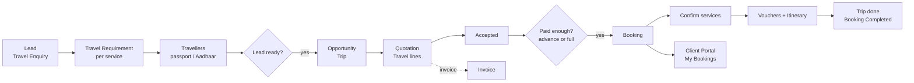
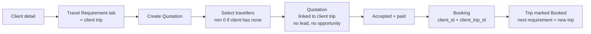
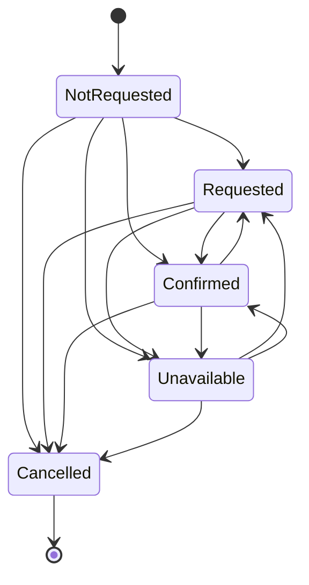

# crm-travel — Workflow

Travel extension `travel` **2.34.0**, needs CRM `openext-crm-suite` **>= 3.59.0 < 4.0.0** (GST suite).

This file explains, in simple English, how a travel enquiry moves through the CRM: from the first lead to
the trip, the booking, vouchers and the client portal.

> The CRM plugin stays generic. All travel logic lives in this extension. The CRM only calls the routes and
> hooks that `crm-extension.json` declares.

*Worked example picture (sample data: the Shah Family, Surat → Goa): `Refactor\documentation\crm-travel-workflow\workflow-example.png` (SVG version next to it). It is kept outside this folder because an extension package may only contain `json/`, `ui/`, `api/` and root `.json` / `.md` / `.txt` files; a `docs/` folder makes the CRM refuse the upload.*

---

## 1. The big picture

There is a second way to start, for a client who already exists (section 7): **Client → Travel Requirement →
Quotation**, with no new lead.

---

## 2. Pipeline stages (Travel Sales Pipeline)

| Stage | Type | Probability |
| --- | --- | --- |
| Enquiry Received | OPEN | 15% |
| Requirements Gathered | OPEN | 30% |
| Quotation Sent | QUOTATION_SENT | 70% |
| Itinerary Proposed | OPEN | 78% |
| Negotiation / Revision | NEGOTIATION | 85% |
| Booking Confirmed | WON | 100% |
| Cancelled / Lost | LOST | 0% |

A new trip opportunity starts at **Enquiry Received** and moves to **Requirements Gathered** when the lead
is ready.

---

## 3. Step 1: Lead (Travel Enquiry)

On **Create Lead**, for the request type *Travel Enquiry*, staff fill in:

| Section | Fields |
| --- | --- |
| Traveller Details | Adults, Children, Infants, Total Travellers (calculated) |
| Travel Information | From, To, Destination, Travel Start / End Date, Number of Days (calculated), Travel Month (calculated), Date Flexibility |
| Required Services | Services enabled on the **Services & Forms** page (hotel, flights, transport, excursion, package...) |

Checks while creating the lead (CRM):
- **Duplicate contact** banner: use the existing contact or create a new one.
- **Existing Client Found** modal: the company, or the picked contact, already belongs to a client.
  - **Add as Secondary Contact**: the person is added to that client. The client keeps 1 Primary and can have many Secondary contacts (max 50).
  - **Continue Creating Lead**: a normal new lead.
  - **Sync Travel Information to Client** checkbox: copies the lead's Travel Information into the client's Travel Requirement (Step 1). It is hidden when the client's open trip already has a quotation.
- **Assigned To** shows only real users' names, never raw IDs.

The same Existing Client Found modal also runs on **Client Create** and **Contact Create**.

---

## 4. Step 2: Travel Requirement (lead tab)

- There is one form per selected service. The forms are built by admins in **Services & Forms**.
- Each form has a status: **Not started → Draft** (required details missing) **→ Complete**.
- A lead can need several of the same service (for example 2 hotels): use **+ Add another Hotel**. There can be at most 20 per service.
- **Remove** keeps the record (marked removed). It is refused while the requirement is on a booking.
- **Check availability** on a Complete requirement records:
  - the provider and a status: **Available / Held / On Request / Unavailable**;
  - the price, currency, and "valid until" (required for Held);
  - the channel (Phone, WhatsApp, Email, Website, Other) and an evidence file.
- Available does **not** mean booked. The quotation later takes the rate and provider from the latest valid check.

---

## 5. Step 3: Travellers (lead tab)

- Add each person: name, date of birth, passport, Aadhaar and PAN card details.
- **PAN and Aadhaar numbers are required** for Indian travellers aged 18 or more (a blank nationality counts as
  Indian, no date of birth counts as 18+). Settings → Travel → "PAN card required" / "Aadhaar card required"
  can change this to every traveller or optional. Older travellers are asked for them when next edited.
- **OCR** can read a passport, Aadhaar or PAN card image to fill the form.
- Document numbers are **encrypted and masked**. Files go to **S3 only**, never to local disk.
- A duplicate check runs before saving; travellers can be copied from the contact's other leads.
- A daily **passport alert** job warns about passports that are expiring.
- The **Travellers** page in the sidebar lists everyone, with document status.

---

## 6. Step 4: Lead ready → Opportunity → Quotation

### Lead readiness (Settings → Travel)

| Setting | Default | Meaning |
| --- | --- | --- |
| `ready_all_services_complete` | on | Every required service has a Complete requirement (off: at least one) |
| `ready_min_travellers` | 1 | At least this many travellers on the lead |
| `ready_requires_availability` | off | Every Complete requirement also needs a current availability check |

When the lead is ready, the CRM enables **Create Opportunity** and can move the lead to Qualified.

### Opportunity ("New Trip Opportunity")
- Trip details, travellers and budget are filled from the lead.
- The opportunity tab **Trip** shows the trip summary.

### Quotation ("New Travel Quotation")
- An opportunity is required (for the lead flow).
- **Lines are fixed**: they come from the Travel Requirement, one line per service, and staff enter only the rate and tax.
- To change the route, dates or class, use **Edit Travel Requirement**.
- Lines are grouped as Flights, Hotel, Transfers, Activities, Visa, Insurance and Other. Each line has extra fields: availability, date, route, cabin class, room type, meal plan and provider.
- Per-person services use the traveller count. If there are no travellers, they are quoted for 1 person and a warning is shown.
- "Valid till" cannot be later than the travel start date.
- **Price per person** can be shown (setting `show_price_per_person`).
- On save, the CRM calls the hook `/sales-flow/quotation-saved`; the stage moves to **Quotation Sent**.
- A revision (R1, R2...) keeps the same links.

---

## 7. Other start: quotation from an existing Client (no new lead)

Use this when the lead is already converted into a client and the client wants a new trip.

- The client's Travel Requirement is a **client trip** record (`ClientTravelRequirement`). Status: **Draft → Complete → Quoted → Accepted → Booked**.
- **One requirement → one accepted quotation (2.30.0).** Once its quotation is **Accepted**, the requirement is **used**:
  "Create Quotation" is hidden for it, and it stays visible under **Used Travel Requirements**. Use **Add New
  Travel Information** (empty, or *Copy from last requirement*) and Save: that new requirement gets its own
  Create Quotation. A used requirement is never reopened. The CRM (3.54.0) also refuses a second accepted
  quotation for the same requirement.
- **Create Quotation** opens the travellers picker:
  - choose from the client's saved travellers (expired passports are refused);
  - if the client has **no** saved travellers, the quotation can be created with none (quoted for 1 person).
- The quotation stores `extensionRecordId` (the trip id). **No lead and no opportunity are created.**
- Prefill, dates, lines and hooks all read from the trip record.
- When it is booked, the trip is closed (**Booked**). The client's next requirement starts a new trip.

Known limits:
- New travellers cannot be added to a client trip (no lead to hold them).
- Travel reports are still lead-based.

---

## 8. Step 5: Accept → payment → Booking

1. The client (or staff) **accepts** the quotation. The CRM calls `/sales-flow/quotation-accepted`.
2. **Payment rule** (CRM Settings → General, verified payments only):
   - the **advance** is paid when the advance option is allowed, otherwise the **full amount** is needed;
   - the CRM calls `/sales-flow/quotation-paid` after each verified payment (Razorpay, webhook or staff).
3. When the rule passes, a **Booking** is made:
   - automatically (setting `auto_create_booking_on_accept`), or
   - with the **Create Booking** action on the quotation.
4. Rules:
   - one booking per quotation;
   - one **booking service** per quotation line;
   - travellers come from the lead, or from the client trip;
   - the booking number uses `booking_prefix`.
5. Not paid yet → `409 QUOTATION_NOT_PAID`, and no booking.

The booking's travellers are **fixed**. There is no "Choose travellers" button, and the server refuses changes (`BOOKING_TRAVELLERS_FIXED`).

---

## 9. Step 6: Confirm services, vouchers, itinerary

### Booking service status

- **Confirm** a service with a reference number or an evidence file (S3).
- Provider documents (tickets and so on) can be attached to each service.

### Booking status (calculated from its services)

| Services | Booking |
| --- | --- |
| All active services Confirmed | **Confirmed** |
| Some Confirmed | **Partially Confirmed** |
| None Confirmed | **Pending** |
| All Cancelled | **Cancelled** |

- **Cancel booking**: a reason is required. Its services and live vouchers are cancelled too.
- **Complete booking**: allowed when the booking is Confirmed and the trip has ended (setting `allow_early_completion` allows it earlier).

### Scan supplier ticket / voucher (2.33.0)
- In **Confirm service**, "Scan supplier ticket / voucher" reads an air ticket, hotel confirmation or supplier bill (PDF, first 5 pages, or a photo).
- It fills **Provider**, **Confirmation reference** (PNR / confirmation no.) and **Final confirmed details** (flights, stay, ticket numbers, names). Prices are never read.
- It warns when a name is not a traveller on the booking, a traveller is missing, or the dates differ from the service.
- Empty fields are filled; typed values change only with "Use scanned values". Nothing is saved until **Save**; the file becomes the evidence file (stored on S3).
- Customer invoices still come only from the accepted quotation, so the CRM's "Scan PDF" is not shown on Invoices or Quotations.

### Vouchers (hotel, transport, excursion)
- Status: **Draft → Issued → Sent → Used**, or **Cancelled**. A reissue makes the old voucher **Superseded**.
- Vouchers are PDFs, versioned, stored on S3.
- The permission `x.travel.vouchers.issue` is needed.

### Itinerary
- A day-by-day plan generated **from the quotation** (Draft → **Final**; a new version makes the old one Superseded).
- It is a PDF and can be opened from the quotation tab **Booking & itinerary** or from the booking.

---

## 10. Invoice

- The invoice is made **from the quotation** (`invoiceFromQuotation`), with travel lines and the "Travel Summary" print layout.
- Recurring invoices, invoice templates and write-off are hidden for travel.

---

## 11. Client Portal

Who can log in:
- the client's **Primary** contact and **Secondary** contacts (full access to that client's data).

How to give access:
- Use **Give Portal Access** on the Lead, Opportunity or Client detail page, or the manager approves a request.
- The OpenNext user is created (or reused by email) and gets the CRM role **"Client / Customer Portal (openext-crm-suite)"**.
- The role is **verified** before portal access is marked assigned. If it fails, nothing is marked.
- A staff account's email is refused (`PORTAL_USER_IS_STAFF`).

What the client sees:
- **Quotations**, **Invoices** and **Bookings** ("My Bookings") for their own client and leads, including client-trip bookings.
- Ticket and voucher downloads. These are private S3 files, and only the owner can download them.
- The sidebar is built on the server per user (`/admin-nav`). Staff-only pages are hidden.

---

## 12. Where things appear

| Place | Travel adds |
| --- | --- |
| Sidebar (staff) | Travellers, Bookings, Services & Forms (admins) |
| Sidebar (portal) | Bookings (My Bookings) |
| Lead detail | Travel Requirement, Travellers, Bookings tabs |
| Opportunity detail | Trip tab |
| Quotation detail | Booking & itinerary tab |
| Client detail | Travel Requirement, Travellers, Bookings tabs |
| Contact detail | Travellers tab |
| Settings → Travel | Locations, readiness rules, availability, booking prefix, time zone... |
| Reports / Dashboard | Enquiries to trips, revenue and collections, services, destinations, upcoming trips, traveller readiness |

Hidden CRM modules for travel: Sales Orders, Samples, Projects, Tasks, Time Logs, Payments, Tickets; Settings → Users.

---

## 13. Permissions

| Permission | Given with | Allows |
| --- | --- | --- |
| `x.travel.bookings.read` | `crm.leads.read` | See bookings, services, confirmations, vouchers, documents |
| `x.travel.bookings.write` | `crm.leads.write` | Create bookings, request / confirm / cancel services, cancel / complete bookings |
| `x.travel.vouchers.issue` | `crm.leads.write` | Issue, reissue, mark sent / used, cancel vouchers |

Money (rate, amount, total) is shown only to users with `crm.finance.read`.

---

## 14. Safety rules (always)

- **Tenant isolation**: every read and write is scoped to the tenant.
- **Audit trail**: entries hold ids only, never document numbers or prices.
- Passport, Aadhaar and PAN numbers are **encrypted, masked, never exported and never logged** in full.
- **Files only on S3** (private). Nothing is stored on local disk.
- Changes to data are **additive**: old records stay safe if the extension has a problem.

---

## 15. Quick status cheat-sheet

| Record | Statuses |
| --- | --- |
| Travel Requirement (lead) | Not started, Draft, Complete |
| Client trip | Draft, Complete, Quoted, Booked |
| Availability check | Available, Held, On Request, Unavailable |
| Booking | Pending, Partially Confirmed, Confirmed, Cancelled, Completed |
| Booking service | Not Requested, Requested, Confirmed, Unavailable, Cancelled |
| Voucher | Draft, Issued, Sent, Used, Cancelled, Superseded |
| Itinerary | Draft, Final, Superseded |
